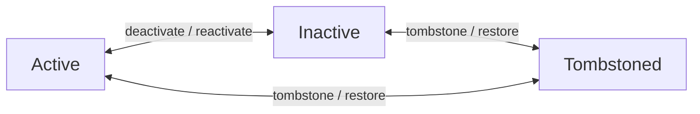

## Summary

Two questions came out of the ingestion discussion:

1. When a holon is tombstoned, is it closed?
2. Can a holon be closed and a new one opened from its closing fluent states, boundaries and referenced entities?

Phase 1 answers the first and lays the ground for the second. A holon is **Active**, **Inactive** or **Tombstoned**. Inactive and Tombstoned holons can be read but not mutated. A Tombstoned holon is also hidden from discovery. Every transition is reversible. Succession (the second question) is not built; it is Phase 3.

## Decisions

These are the Phase 0 decisions and how Phase 1 applies each.

| Question | Decision | Applied as |
|---|---|---|
| State names | Chosen as appropriate | Active, Inactive, Tombstoned. "Closed" is avoided: the Holonitype ruling already uses open/closed for a boundary condition. |
| Is the end terminal? | No. A holon is active or inactive; inactive can be queried but not mutated, and can be reactivated. | Any state moves to any other. Absence of a lifecycle fluent means Active. |
| Who may change it? | An admin certainly; a trigger process possibly (energy minimisation). | The same write grants as `/fluent/update`, which admins hold. Trigger-driven deactivation is deferred: it needs a new trigger action kind. |
| Does Tombstoned hide a holon? | Hidden from discovery, but readable. | Neighbour traversal excludes Tombstoned holons unless `include_tombstoned` is set. `get_holon` on its IRI still works. |
| Fluents still holding a live value | Final-state fluents transfer to the new holon. | That is succession (Phase 3). Plain deactivation leaves values standing and clips nothing; reactivation resumes. |

## The model

<!-- databook:id: lifecycle-diagram -->
<!-- mode=rendered -->


- **Active.** The holon accepts fluent changes and appears in discovery. A holon with no lifecycle fluent is Active.
- **Inactive.** Readable and discoverable, but its fluents refuse changes.
- **Tombstoned.** Inactive, and also left out of neighbour discovery. Its ledger is intact, so as-of reads and provenance still work.

### Lifecycle is a fluent

The state is a `holon:Fluent` on the holon, using the property `hb:lifecycleStatus` in `SetValueMode`. History, valid time and as-of reads come from the existing ledger. The fluent is created on the first change and its IRI is derived from the holon, so there is one per holon. The property is declared in the ontology graph the first time it is needed.

<!-- databook:id: lifecycle-vocabulary -->
```turtle
@prefix hb:     <https://w3id.org/holonbridge/> .
@prefix holon:  <https://w3id.org/holon/> .
@prefix rdfs:   <http://www.w3.org/2000/01/rdf-schema#> .
@prefix ex:     <https://example.org/> .

hb:lifecycleStatus a holon:FluentProperty ;
    holon:fluentOperationMode holon:SetValueMode ;
    rdfs:label "lifecycle status" ;
    rdfs:comment "Active, Inactive or Tombstoned. Absent means Active." .

hb:Active     rdfs:label "Active" .
hb:Inactive   rdfs:label "Inactive" .
hb:Tombstoned rdfs:label "Tombstoned" .

# What a holon looks like after its first change (placeholder names):
ex:Season2026 hb:lifecycleStatus ex:Season2026-lifecycle .
ex:Season2026-lifecycle a holon:Fluent ;
    holon:fluentProperty hb:lifecycleStatus ;
    holon:currentValue hb:Inactive .
```

### Governance, in the portal manner

`hb:lifecycleStatus` is governed. `/fluent/update`, `/fluent/update-many`, a trigger's fluent action and a portal crossing all refuse to write it (409 `lifecycle_governed`); only `POST /holon/lifecycle` changes it. The same four paths refuse to change any fluent whose holder is Inactive or Tombstoned (409 `holon_inactive`, naming the holon). One function, `write_block`, makes both decisions, so the four paths cannot drift apart. It fails closed: if the lookup errors, the write is refused.

A fluent update names a fluent, not a holon, so `write_block` finds the holder with a reverse lookup. If a fluent has several holders, the stricter state wins.

## Interface

| Call | Purpose |
|---|---|
| `POST /holon/lifecycle` `{holon, state, reason?, effective_at?}` | Change state. A request for the current state is a no-op. The reason goes into the ledger description. `effective_at` backdates the valid time. |
| `GET /holon/lifecycle?iri=` | Current state and since when. |
| `GET /holon?...&include_tombstoned=true` | Include Tombstoned neighbours. `get_holon` also reports `lifecycle` in its frontmatter. |
| MCP: `set_holon_lifecycle`, `get_holon_lifecycle` | The same, for agents. |

The write needs the same grants as a fluent update on the events, scene and sequences graphs, plus the holons graph (it creates the fluent node), plus the ontology graph the first time. Errors: 401 without identity, 403 without a grant, 404 for an unknown holon, 400 for an unknown state.

## What this does not do

This is the part to read before relying on it.

- **The structural freeze is not a seal.** Phase 2 (below) guards Turtle writes and the subjects a SPARQL update names outright. A SPARQL update whose subjects come from its WHERE clause, a whole-graph operation (CLEAR, DROP, LOAD, COPY, MOVE, ADD), named-rule writes and `/graph-op` are not checked; they stay an access-control matter.
- **Discovery filtering is built into neighbour traversal only.** An arbitrary SPARQL query will still return Tombstoned holons. `tombstoned_filter` is the pattern to add to a query that should hide them.
- **As-of reads show current lifecycle state**, not the state at `observed_at`; the frontmatter says so.
- **No trigger action** that changes lifecycle yet.
- **No succession.** A holon is not prevented from being reactivated after a successor exists, because successors do not exist yet.
- **Terminology.** The Holonitype open/closed (boundary condition) still needs a ruling so the words stay distinct.

## Next phases

### Phase 2: structural freeze (built)

`structural_freeze.structural_block` runs on every Turtle write (`/holon`, `/graph/push`, `/ingest`, `/message/create`, trigger rule writes, all through `write_turtle_to_graph`) and on `/sparql/update`. It refuses with a 409 when:

| The write | Refused as |
|---|---|
| has an Inactive or Tombstoned holon as a subject | `holon_inactive` |
| has a fluent of such a holon as a subject (this closes the route round to the scene graph) | `holon_inactive` |
| uses `hb:lifecycleStatus` as a predicate, or has a lifecycle fluent as a subject | `lifecycle_governed` |
| replaces a graph that holds any of the above, or any lifecycle state | `holon_inactive`, kind `replace` |
| cannot be read (RDF 1.2) while any holon is Inactive or Tombstoned | `holon_inactive`, kind `unreadable` |

An unreadable payload is allowed in a dataset where every holon is Active, so RDF 1.2 writes are not penalised. A replace of a graph holding lifecycle state is refused even when every holon is Active, because the replace would drop that state; use merge, or write to another graph. Fuseki errors during the check refuse the write rather than let it through.

The check runs after the access-control decision and before the write lock. `POST /holon/lifecycle` writes its own fluent directly, so the freeze does not stand in its way.

### Phase 3: succession
One transition that deactivates A, creates B, seeds B's fluents from A's final values (each new assertion carrying `prov:wasDerivedFrom` to A's), links predecessor and successor, and re-registers referenced entities, in a single request. This extends `fluent_transaction` to the holons graph. It needs list-mode fluents to work in as-of reads, portal resolution through the successor, and a rule that a holon with a successor refuses reactivation. One dataset only; cross-dataset succession would need a saga.

### Phase 4: trigger-driven deactivation
A new trigger action kind, so a process (for instance one minimising energy) can deactivate holons without an admin in the loop.

## Open questions

- Do relationship holons close when either end goes inactive, or only when both do?
- Should a reason be mandatory for Tombstoned?
- Should succession be allowed across holonitypes?
- If B's seeding fails SHACL, does the whole succession fail (proposed), or does B open empty?

## Where to look

- `holonbridge/lifecycle.py`: states, `set_state`, `write_block`, `tombstoned_filter`.
- `holonbridge/routes/lifecycle.py`: the two routes and their grants.
- `holonbridge/structural_freeze.py`: the subject guard for Turtle writes and SPARQL updates.
- `holonbridge/routes/fluent.py`, `fluent_trigger_action.py`, `portal.py`: the guard sites.
- `tests/test_lifecycle.py`, `tests/test_structural_freeze.py`: 66 tests against rdflib's SPARQL engine, not a live Fuseki.
