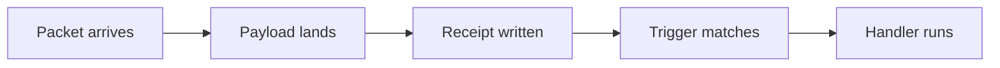

## Summary

A packet is a DataBook in transit. Until now the bridge read two things from one
(`graph.named_graph` and its first RDF block), landed the block, and discarded
the rest. How it was processed was whatever the *caller* put in the request.

The accompanying pull request changes one thing. After the payload lands, the
bridge writes a **receipt** for the packet into the dataset's `inbox` graph and
lets the existing trigger machinery see it. A named trigger whose condition is
"a packet claiming profile *X* has been received" then runs a handler: a named
rule, an agent call, or a fluent update. **Which handler runs is data in the
graph, not code in `/ingest`.**

> **Note:** This is the first of several ingestion scenarios. It deliberately
> builds only the mechanism, and the scenarios in
> [Scenarios](#scenarios) build on it.

| | Before | After this change |
|---|---|---|
| Header of an ingested DataBook | Read for `graph.named_graph`, then discarded | Recorded as claims on a receipt; its RDF (if it carries a `@context`) kept in a per-packet graph |
| Who decides how a packet is processed | The caller, per request (`pipeline`, `params`) | The graph: a trigger bound to the packet's claimed profile |
| Can anything in the graph react to an arrival | No | Yes, through the same post-write hook every other write uses |
| Re-sending the same document | Re-lands it | Recorded as a `Duplicate`; not dispatched again |
| Raw Turtle or a graph-to-graph ingest | Unchanged | Unchanged (no header, so no packet) |

## The model

Three ideas, in the order they matter.

**1. Claims are not facts.** Everything the bridge says about the *receipt* is
something it observed: when it arrived, who sent it (the authenticated identity,
never a header field), the payload's hash, which graph the payload landed in.
Everything the *document* says about itself (`id`, `type`, `profiles`) is a
claim, and is recorded under claim predicates (`hb:declaredId`,
`hb:declaredType`, `hb:declaresProfile`).

**2. The header never names a handler.** A sender chooses *what kind of thing it
is sending*. The receiving graph chooses what happens to that kind of thing. A
header that could name a named query to run would be a remote call chosen by the
sender, running with the handler's authority rather than the sender's. A claimed
profile is only a lookup key into bindings the receiver controls.

**3. The inbox is a receipt log, not a work queue.** The bridge writes
`Received` or `Duplicate` and never changes it. What a handler did is recorded
where the handler works: the trigger's firing ledger, the handler's own output
graph (derived triples should say `prov:wasDerivedFrom` the packet), and an
agent's call ledger.

### How this fits the flavour direction

The team's direction is that Semantic YAML-LD Markdown flavours (OKF, Vault-LD,
DataBook) are distinct profiles, each with its own SHACL-defined format, and that
interoperation is a SHACL-based transformation rather than a shared vocabulary.
Packets are where that becomes operational: the claimed profile IRI is the
dispatch key, and registering a flavour amounts to registering a trigger plus the
shapes and the mapping rule it runs. The bridge never needs to know what OKF is.
The graph does.

## What happens on arrival

<!-- databook:id: arrival-flow -->
<!-- mode=rendered -->


1. **Payload lands** through the same gated write as before: ACL check, SHACL
   gate, per-dataset write lock. Nothing about that path changed. A refused
   payload leaves no receipt.
2. **Receipt written** to `urn:{dataset}:inbox`. This happens *after* the
   payload, so a handler that fires on the receipt finds the payload where the
   receipt says it is. If the header carries its own JSON-LD `@context`, its RDF
   goes to a separate graph first (see [Trust model](#trust-model)).
3. **Post-write hook** evaluates state triggers, as it does after any write to
   domain data. The inbox is deliberately *not* a system graph, because writes to
   system graphs skip trigger evaluation.
4. **Trigger matches**: the registered condition (a named SELECT projecting
   `?focus`) returns the packet. Firing is edge-triggered per packet, so a packet
   fires a given trigger once.
5. **Handler runs**: a named rule bound with `$this` set to the packet, an agent
   call, or a fluent update. Triggers default to `reviewRequired`, which stages a
   rule's output as a candidate instead of writing it.

## The receipt

This is real output of the builder (`holonbridge.packet.build_envelope`), shown
with prefixes. It is one subject and fourteen triples.

<!-- databook:id: example-receipt -->
<!-- databook:label: A receipt for a packet claiming one profile and carrying a lifted header -->
```turtle
@prefix hb:  <https://w3id.org/holonbridge/> .
@prefix xsd: <http://www.w3.org/2001/XMLSchema#> .

<urn:example:inbox:7c1e9a52d0b34f6e8a21b5c9e4d3f012>
    a hb:Packet ;
    hb:packetId "7c1e9a52d0b34f6e8a21b5c9e4d3f012" ;
    hb:packetStatus "Received" ;
    hb:receivedAt "2026-11-17T22:14:00+00:00"^^xsd:dateTime ;
    hb:payloadGraph <urn:example:sensor-grid> ;
    hb:payloadHash "sha256:6aa1ab31e8a7ceea8e9b7575c5cc67f8c4d375171979418494a47955e0ef03a5" ;
    hb:payloadBytes "69"^^xsd:integer ;
    hb:ingestMessage <urn:example:message:7c1e9a52d0b34f6e8a21b5c9e4d3f012> ;
    hb:headerLift "lifted" ;
    hb:receivedFrom <urn:example:person:jane-doe> ;
    hb:declaredId "https://example.org/databooks/sensor-report-1" ;
    hb:declaredType "databook" ;
    hb:declaresProfile <https://example.org/profiles/sensor-report> ;
    hb:headerGraph <urn:example:inbox:7c1e9a52d0b34f6e8a21b5c9e4d3f012:header> .
```

| Predicate | Kind | Meaning |
|---|---|---|
| `hb:packetId` | fact | The id of the ingest `hb:Message`; receipt and message are a pair |
| `hb:packetStatus` | fact | `Received`, or `Duplicate` when the same declared id and payload hash were already received |
| `hb:receivedAt` | fact | When the bridge accepted it |
| `hb:receivedFrom` | fact | The authenticated sender. Never taken from the header |
| `hb:payloadGraph` | fact | Where the payload landed |
| `hb:payloadHash`, `hb:payloadBytes` | fact | SHA-256 and size of the payload as received. The payload itself is not copied |
| `hb:ingestMessage` | fact | The `hb:Message` pipeline-status record for this ingest |
| `hb:headerLift` | fact | `none`, `lifted`, or `not lifted: <reason>` |
| `hb:headerGraph` | fact | Where the lifted header RDF is quarantined, if it was lifted |
| `hb:declaredId` | **claim** | The document's own `id` |
| `hb:declaredType` | **claim** | The document's own `type` |
| `hb:declaresProfile` | **claim** | One per entry in the document's `profiles` that is a usable absolute IRI |

## Trust model

**The header's own RDF is quarantined.** If a header carries a JSON-LD
`@context`, the bridge lifts it to RDF using the same path as every other JSON-LD
input (remote contexts refused, named graphs refused). Those triples are the
sender's, so they are written to `urn:{dataset}:inbox:{id}:header`, never to the
`inbox` graph. Otherwise a header could declare a node of type `hb:Packet` with
status `Received` and fire any handler it liked. A test pushes exactly that
header and shows the forged node reaches the header graph and nowhere a
condition looks.

**A lift that fails does not fail the ingest.** The payload has already landed.
The failure is recorded on the receipt (`hb:headerLift`).

**Handlers run as their definer, not as the sender.** A trigger runs with the
authority of whoever armed it, and the bridge re-checks that authority at every
firing. The sender needs only the write grant the payload's graph already
required. Nobody gets to write the `inbox` graph through ordinary routes unless
granted, because write grants fail closed.

**Duplicates are recorded, not dispatched.** The comparison key is declared id
plus payload hash. A document with no declared id has no identity to compare and
is never a duplicate.

**Review is on by default.** A rule trigger registered with `review_required`
true stages its output as a candidate for approval rather than writing it. For an
untrusted flavour that is the right default; for a trusted one, set it false.

> **Warning:** The receipt records the sender's *claim* of a profile. A trigger's
> condition may add its own checks (a join against `hb:receivedFrom` and the
> sender's grants, or validating the payload against the profile's shape before
> acting). Nothing in the mechanism makes that check for you.

## Registering a handler

A handler is three things registered in the dataset. None needs a code change in
the bridge.

**1. The condition**, a named SELECT projecting `?focus`. This is the exact text
the test suite runs against a real dataset, so a drift between it and the receipt
vocabulary fails the build:

<!-- databook:id: condition-profile-received -->
<!-- databook:label: Select packets of one profile that have been received and not duplicated -->
<!-- mode=printed -->
```sparql
PREFIX hb: <https://w3id.org/holonbridge/>
SELECT ?focus WHERE {
  GRAPH <urn:ds:inbox> {
    ?focus a hb:Packet ;
           hb:packetStatus "Received" ;
           hb:declaresProfile <https://example.org/profiles/sensor-report> .
  }
}
```

A condition must not carry its own `LIMIT`: a packet pushed out of a truncated
result would look as though it had stopped matching and be re-armed.

Register it:

<!-- databook:id: register-condition -->
<!-- mode=printed -->
```http
POST /named-query
{
  "id": "sensor-report-received",
  "label": "Sensor reports received",
  "sparql": "PREFIX hb: <https://w3id.org/holonbridge/> SELECT ?focus WHERE { GRAPH <urn:ds:inbox> { ?focus a hb:Packet ; hb:packetStatus \"Received\" ; hb:declaresProfile <https://example.org/profiles/sensor-report> . } }"
}
```

**2. The handler**, here a named rule. The trigger binds `$this` to the packet, so
the rule can find the payload through the receipt. Derived triples say where they
came from. There is no registration endpoint for rules in this codebase; they are
pushed as Turtle into the dataset's `named-rules` graph:

<!-- databook:id: example-named-rule -->
<!-- databook:label: A handler rule that re-types the readings in a packet and records provenance -->
<!-- mode=printed -->
```turtle
@prefix hb: <https://w3id.org/holonbridge/> .

<urn:ds:named-rule:sensor-report-handler> a hb:NamedRule ;
    hb:id "sensor-report-handler" ;
    hb:targetGraph <urn:ds:sensor-readings> ;
    hb:writeMode "Append" ;
    hb:ruleStatus "Active" ;
    hb:construct """
PREFIX hb:   <https://w3id.org/holonbridge/>
PREFIX prov: <http://www.w3.org/ns/prov#>
PREFIX ex:   <https://example.org/ns#>

CONSTRUCT {
  ?reading a ex:SensorReading ;
           ex:value ?value ;
           prov:wasDerivedFrom $this .
}
WHERE {
  GRAPH <urn:ds:inbox> { $this hb:payloadGraph ?payload }
  GRAPH ?payload { ?reading a ex:Reading ; ex:value ?value }
}""" .
```

**3. The trigger** that binds the profile to the handler:

<!-- databook:id: register-trigger -->
<!-- mode=printed -->
```http
POST /named-trigger
{
  "id": "sensor-report-handler",
  "trigger_kind": "StateTrigger",
  "condition": "sensor-report-received",
  "on_fire": "sensor-report-handler",
  "review_required": true,
  "fire_mode": "Edge",
  "watched_predicates": ["https://w3id.org/holonbridge/declaresProfile"]
}
```

`watched_predicates` lets the hook skip this trigger for writes that cannot
affect it; the receipt's predicates are reported to it on every packet.

To see what became of a packet, ask the firing ledger
(`urn:{dataset}:trigger-log`, one entry per trigger and packet), the candidate
queue if review was required, and the handler's output graph. The receipt itself
does not change.

## Scenarios

The mechanism above is one scenario, profile dispatch. The ingestion scenarios
worth building out are variations on it. Status is stated honestly.

| Scenario | The packet says | Handler | Status |
|---|---|---|---|
| **Profile dispatch** | "I am a packet of profile *X*" | Trigger bound to *X*: a rule, an agent call, or a fluent update | **Implemented** by this change |
| **Direct projection invocation** | "Run projection *P* for focus *F*" | Run a named projection and make the result retrievable | **Not yet designed.** Trigger actions are currently rule, agent or fluent query, and none of them is a projection. Either a new action kind or a pipeline `projection` stage would do it |
| **Named query request** | "Run query *Q* with these parameters" | A rule or agent that runs it and writes the result somewhere readable | Possible with a rule today; needs a reply convention (below) |
| **Foreign flavour in, DataBook out** | A document of another flavour (OKF, Vault-LD) | Lift the document to RDF under its profile's context, validate against the profile's shape, run the mapping rule | Needs the flavour package (context, lift rules, shapes); the lift step is not built |
| **Command or update** | "Apply this change" | Validate, authorise, execute, assert, log: the `CommandEvent` shape | Designed at architecture level; the receipt gives it an entry point |
| **Agent request** | "Ask the agent to do *T*" | Trigger with an agent action; the answer arrives as a staged candidate, never a direct write | Mechanism exists (agent gateway); wiring to packets is a trigger registration |

## Open questions

1. **Reply path.** A packet is one-way: the ingest response returns the receipt,
   and a handler's result is read from its output graph. Request/response
   scenarios need a correlation convention (something like `hb:inReplyTo`) and a
   decision about where replies live.
2. **Condition growth.** The firing ledger makes each packet fire once, but the
   condition above keeps returning every packet of the profile ever received. For
   a busy inbox, exclude packets that already have a derived record
   (`FILTER NOT EXISTS` on the handler's output graph) or bound by `hb:receivedAt`.
3. **Sender-gated dispatch.** A condition can join `hb:receivedFrom` against the
   sender's grants, but there is no standard pattern for it yet.
4. **Profile-supplied contexts.** The header is lifted only if it carries its own
   inline `@context`, because remote contexts are refused. An existing file with
   no `@context` (a plain OKF note) needs the flavour registry to supply one.
5. **Body lift.** Only the first `turtle`, `turtle12` or `json-ld` block is
   landed, and `/ingest` passes it to the store as Turtle without converting a
   `json-ld` block (unlike `create_holon` and `create_message`). Flavours whose
   payload is the Markdown body itself (wikilinks as triples, say) need a lift
   step the bridge does not have.
6. **Other DataBook entry points.** `create_holon` and `create_message` take
   DataBook envelopes too and leave no receipt. Whether they should is a
   question about what a packet is.
7. **Switch and retention.** Receipts are always written for DataBook ingests,
   with no setting to turn them off, and nothing prunes the inbox.

## Where to look

| What | Where |
|---|---|
| Receipt builder, header reading and lift, duplicate check | `holonbridge/packet.py` |
| The one call site | `holonbridge/routes/pipeline.py`, the `/ingest` route |
| The new graph role | `holonbridge/conn.py`, `GRAPH_ROLES` |
| Tests, including the real-SPARQL condition test and the forged-header test | `tests/test_packet.py` |
| Trigger machinery this relies on | `holonbridge/triggers.py`, `holonbridge/trigger_hook.py` |
